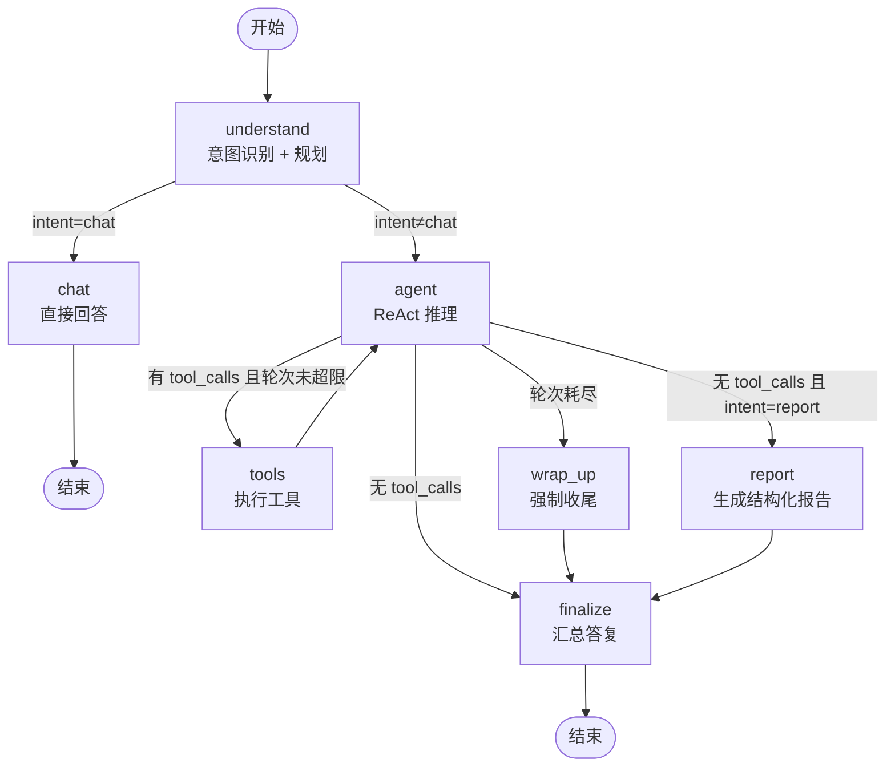

# DataAnalysisAgent · 数据分析 Agent 智能体

上传一个 CSV / Excel，然后用自然语言提问。Agent 会自己判断该调用哪些工具——
数据画像、缺失值检测、数据清洗、统计计算、相关性分析、图表可视化——最后给出带数字的结论，
需要时自动输出一份结构化分析报告。

**技术栈**：Python · LangGraph · LangChain · Tool Calling · Pandas · Matplotlib · FastAPI

---

## 一、能力概览

| 阶段 | Agent 会做什么 |
| --- | --- |
| 数据集解析 | 自动嗅探编码（utf-8 / gbk / gb18030 / utf-16）、推断分隔符、多 Sheet 自动选表、清洗表头 |
| 数据画像 | 识别每个字段的**语义类型**（主键 / 数值 / 金额 / 占比 / 日期 / 布尔 / 类别 / 文本 / 常量 / 全空），输出质量评分与问题清单 |
| 数据预处理 | 缺失值填充、缺失行删除、去重、删列、类型转换、文本规整（去空白 / 统一伪空值）、离群值截断或删除 |
| 统计计算 | 描述统计、分组聚合、频次分布、交叉透视、条件筛选与 Top-N 下钻、相关性分析 |
| 可视化 | 折线图、柱状图、直方图、相关性热力图、散点图（含线性拟合）、箱线图 |
| 报告输出 | 5 章结构：数据概览 / 数据质量体检 / 关键发现 / 图表证据 / 结论与建议，可导出 Markdown 与 HTML |

## 二、与项目需求的对应关系

### 1. 用 LangGraph 搭建工作流，设计状态节点与条件路由，用 Checkpoint 持久化多轮上下文

- 状态定义：`backend/app/graph/state.py` —— `messages` 用官方 `add_messages` reducer 追加，
  `evidence` / `artifacts` 是**每轮重置**的普通字段，保证前端拿到的永远是本轮产物。
- 7 个节点 + 4 条条件路由：`backend/app/graph/nodes.py`、`backend/app/graph/builder.py`

| 节点 | 职责 |
| --- | --- |
| `understand` | 意图识别（chat / overview / cleaning / statistics / visualization / report）+ 生成执行计划 |
| `chat` | 闲聊与能力咨询，不触发任何工具 |
| `agent` | ReAct 主体，基于意图绑定工具集合并决定调用 |
| `tools` | 执行工具，回收证据与图表产物 |
| `wrap_up` | 工具轮次耗尽后的强制收尾，避免无限循环 |
| `report` | 把画像 + 证据 + 图表整合成结构化报告 |
| `finalize` | 收口，确定最终答复与状态 |



- **Checkpoint 持久化**：`backend/app/graph/checkpointer.py` 里的 `SqliteCheckpointSaver`。
  官方 `InMemorySaver` 只存在内存里，进程一重启多轮上下文就没了；官方 SQLite 版本是需要额外
  安装的独立包。这里直接在 `InMemorySaver` 基础上做**写穿透 + 启动回放**：完全复用官方读取逻辑，
  只在 `put` / `put_writes` / `delete_thread` 三个写入点同步落库，启动时把三张表装回内存结构。
  于是同一个 `thread_id`（会话）可以在**服务重启后继续对话**，历史消息、证据、图表全部还在。

### 2. 封装数据分析工具集，Agent 自主决策是否触发工具

- 工具实现：`backend/app/tools/` —— 共 **23 个**工具，分 4 组（画像诊断 / 清洗 / 统计查询 / 可视化）。
- 每个工具的 docstring 就是给模型看的说明书；返回统一 JSON 信封：
  `{ok, tool, summary, data, table, markdown}`，`summary` 是一句话结论，`markdown` 是图表引用。
- **路由感知的工具绑定**（`tools/registry.py`）：`chat` 不绑定工具，`statistics` 只暴露统计类，
  只有 `report` 才放开全部工具。既降低选错工具的概率，也省 token。
- 工具内部统一做列名模糊匹配、异常转成 `ok:false` 的可读错误（模型可以自行纠错重试）。

### 3. 数据集自动解析 + 图表指标整合成自然语言结论

- 解析与画像：`backend/app/dataset/loader.py`、`backend/app/dataset/profiler.py`。
- 报告合成：`backend/app/report/composer.py`。章节骨架由程序固定（结构稳定、数字准确），
  叙述内容由大模型生成（`ReportNarrative` 结构化输出），图表与表格由程序渲染后拼装，
  最终同时产出 Markdown 与带样式的独立 HTML。

## 三、目录结构

```
DataAnalysisAgent/
├─ run.py                       # 一键启动
├─ requirements.txt
├─ .env / .env.example          # 模型与运行时配置
├─ backend/app/
│  ├─ main.py                   # FastAPI 应用（挂载接口与内置前端）
│  ├─ config.py                 # pydantic-settings 配置
│  ├─ schemas.py                # 请求 / 响应模型
│  ├─ core/
│  │  ├─ llm.py                 # 模型工厂（OpenAI 兼容协议，默认 DeepSeek）
│  │  └─ store.py               # 数据集 / 会话 / 报告 / 图表 的 SQLite 元数据
│  ├─ dataset/
│  │  ├─ loader.py              # 编码嗅探、分隔符推断、多 Sheet、表头清洗
│  │  └─ profiler.py            # 语义类型推断、质量体检、数据字典
│  ├─ tools/
│  │  ├─ context.py             # 工具上下文（ContextVar 注入当前数据集）
│  │  ├─ base.py                # 返回信封、列名解析、Markdown 表格
│  │  ├─ profiling.py           # 5 个画像诊断工具
│  │  ├─ cleaning.py            # 8 个清洗工具
│  │  ├─ statistics.py          # 3 个统计工具
│  │  ├─ query.py               # 1 个筛选工具
│  │  ├─ visualize.py           # 6 个可视化工具
│  │  └─ registry.py            # 分组、意图绑定、工具清单
│  ├─ graph/
│  │  ├─ state.py / prompts.py / nodes.py / builder.py / runner.py
│  │  └─ checkpointer.py        # SQLite 持久化 Checkpoint
│  ├─ report/composer.py        # 结构化报告合成（Markdown + HTML）
│  └─ api/                      # datasets / chat / reports / artifacts / system
├─ frontend/                    # 原生 HTML + CSS + JS 控制台（无需构建）
├─ data/samples/                # 示例数据集（含缺失、重复、离群点）
├─ tests/                       # 29 个离线测试（不依赖 pytest、不联网）
└─ storage/                     # 运行时生成：uploads / artifacts / reports / *.db
```

## 四、快速开始

```bash
# 1. 依赖（Python 3.10+，实测 3.13）
pip install -r requirements.txt

# 2. 配置模型：复制 .env.example 为 .env，填入 API Key
#    LLM_API_KEY=sk-xxx
#    LLM_BASE_URL=https://api.deepseek.com
#    LLM_MODEL=deepseek-chat

# 3. 启动
python run.py                 # 自动打开浏览器
python run.py --no-browser    # 只起服务
```

打开 <http://127.0.0.1:8000> 就是控制台；<http://127.0.0.1:8000/docs> 是自动生成的接口文档。

想先试试效果，直接上传 `data/samples/电商订单_示例数据.csv`，然后点几个快捷指令，例如
「各地区销售额对比，用柱状图展示」或「生成完整报告」。

> 默认配置走 DeepSeek（OpenAI 兼容协议）。要换模型只改 `.env` 里的 `LLM_BASE_URL` 与 `LLM_MODEL` 即可；
> 注意 `LLM_STRUCTURED_METHOD` 保持 `function_calling`——DeepSeek 目前不支持 `response_format=json_schema`。

## 五、接口清单

| 方法 | 路径 | 说明 |
| --- | --- | --- |
| POST | `/api/datasets/upload` | 上传并解析数据集（multipart，可选 `sheet` / `name`） |
| GET | `/api/datasets/` | 数据集列表（含质量评分） |
| GET | `/api/datasets/{id}` | 数据集详情 + 完整画像 |
| GET | `/api/datasets/{id}/profile?refresh=true` | 重新计算画像 |
| GET | `/api/datasets/{id}/brief` | 给模型看的轻量数据字典 |
| GET | `/api/datasets/{id}/preview?offset=&limit=` | 分页预览当前工作副本 |
| POST | `/api/datasets/{id}/reset` | 放弃清洗改动，恢复到最初上传的版本 |
| DELETE | `/api/datasets/{id}` | 删除数据集及其工作副本 |
| POST | `/api/chat/` | 同步执行一轮分析 |
| POST | `/api/chat/stream` | **SSE 流式**返回每个节点的进展与工具调用 |
| GET | `/api/chat/history/{conversation_id}` | 从 checkpoint 读取完整多轮上下文 |
| GET | `/api/chat/conversations?dataset_id=` | 会话列表 |
| DELETE | `/api/chat/conversations/{id}` | 删除会话（含 checkpoint） |
| POST | `/api/reports/` | 一键生成完整分析报告 |
| GET | `/api/reports/{id}` | 报告详情（Markdown + HTML + 结构化 payload） |
| GET | `/api/reports/{id}/download?fmt=html\|md` | 下载报告文件 |
| GET | `/api/artifacts/{id}` | 下载图表 PNG |
| GET | `/api/health` · `/api/tools` · `/api/graph` | 健康检查 / 工具清单 / 工作流 Mermaid 源码 |

命令行调用示例：

```bash
curl -F "file=@data/samples/电商订单_示例数据.csv" http://127.0.0.1:8000/api/datasets/upload
curl -X POST http://127.0.0.1:8000/api/chat/ \
  -H "Content-Type: application/json" \
  -d '{"dataset_id":"Dxxxx","message":"各地区的销售额对比，画柱状图"}'
```

## 六、工具清单（23 个）

| 分组 | 工具 |
| --- | --- |
| 数据解析与质量诊断 | `dataset_overview` `detect_missing_values` `analyze_column` `detect_outliers` `correlation_analysis` |
| 数据清洗 | `fill_missing` `drop_missing_rows` `drop_duplicates` `drop_columns` `convert_types` `normalize_text` `clip_outliers` `restore_original_data` |
| 统计计算与查询 | `compute_statistics` `value_counts` `pivot_table` `filter_rows` |
| 可视化 | `plot_line` `plot_bar` `plot_histogram` `plot_heatmap` `plot_scatter` `plot_box` |

## 七、几个值得说的设计取舍

**1. 清洗作用在「工作副本」上，原始文件永不改动。**
每次清洗生成 `storage/uploads/{id}_v{n}.csv` 并把 `revision + 1`，同时刷新画像；
`restore_original_data` 工具和 `POST /reset` 接口都能一键回到初始数据。
Agent 因此可以放心做预处理，用户也随时能反悔。

**2. numpy 标量差点毁掉整个 Checkpoint。**
`np.float64` 是 Python `float` 的**子类**，`round()` 之后仍是 numpy 类型，
而 LangGraph 的 checkpoint 用 msgpack 存储状态，遇到 numpy 标量会直接抛
`Type is not msgpack serializable`。所以所有进入状态的数据都强制过一遍
`profiler.to_native()`（递归转原生类型 + JSON 往返），并有专门的回归测试守着。

**3. 流式接口下 ContextVar 会失效。**
工具靠 `ContextVar` 拿当前数据集，但 Starlette 在线程池里逐次 `next()` 同步生成器，
每次恢复都发生在拷贝出来的新上下文，生成器开头的赋值会丢。`runner.stream_agent()`
因此在每次恢复执行前重新绑定上下文（并吞掉跨 Context 的 token 复位异常）。
这个问题只在 HTTP 流式路径出现，直接调用 `stream_agent()` 是复现不出来的。

**4. 结构化输出要挑对方法。**
`langchain_openai` 的 `with_structured_output()` 默认可能走 `json_schema` 响应格式，
DeepSeek 会返回 400。这里显式指定 `method="function_calling"`，并保留
「要求模型只输出 JSON」的纯文本兜底，保证换模型也不会整条链路挂掉。

**5. 图表统一进产物库。**
每张图保存为 PNG 并在 `artifacts` 表登记 `id / title / description / path`，
工具返回 `markdown` 引用（``），模型可以直接写进回答，
报告合成器也能把它们插到「图表证据」章节。

## 八、测试

```bash
python tests/run_tests.py
```

29 个离线用例，**不需要 pytest、不需要联网、不调用大模型**，覆盖：
编码与分隔符嗅探、表头规范化、语义类型推断、质量体检、
全部 23 个工具（含错误路径与 numpy 原生类型回归）、
Checkpoint 多轮持久化与「模拟进程重启」、
以及全部 HTTP 接口的冒烟测试。测试使用独立的 `.test-storage/` 目录，不污染 `storage/`。

想验证大模型链路，可以在服务起来后直接跑示例数据集里的快捷指令，或执行：

```bash
python -c "from backend.app.graph.runner import run_agent; print(run_agent('Dxxxx','各地区的销售额对比，画柱状图')['answer'])"
```

## 九、已知限制

- **单机形态**：Checkpoint 与元数据都用本地 SQLite，适合单机单进程；要做多副本部署需要换 Postgres/Redis。
- **静态图表**：输出 PNG。要交互式图表可以把 `tools/visualize.py` 换成 Plotly 并前端内嵌。
- **无鉴权**：默认只监听 `127.0.0.1`，定位是本地分析工具，未做用户体系。
- **`.xls` 老格式**需要额外 `pip install xlrd`；建议先另存为 `.xlsx`。
- 单次分析的行数上限由 `.env` 的 `MAX_ROWS` 控制（默认 20 万行），超出会截断并提示。
